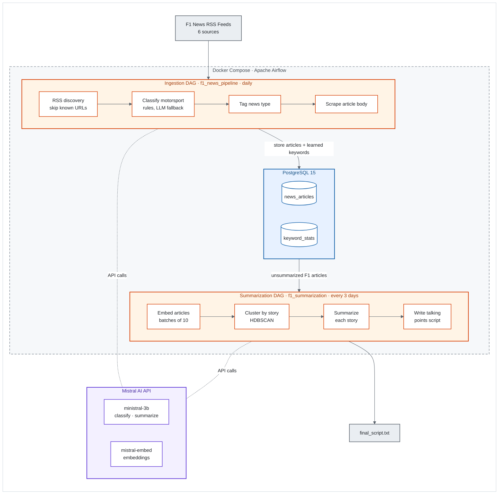

# F1 News Intelligence Pipeline

Scrapes Formula 1 news from RSS feeds, filters out other motorsports, groups articles that cover the same story, and generates a talking-points script with an LLM.

## Architecture



## How it works

**Ingestion** (`f1_news_pipeline`, daily)

1. Reads the RSS feeds listed in `config/config.py` and skips URLs already in the database.
2. Classifies each title as F1, Formula E, MotoGP, etc. A keyword match runs first. The LLM is called only when no category clearly wins. Entities the LLM returns 4 or more times are added to the keyword list and saved in `keyword_stats`.
3. Tags each article as hard news, opinion or explainer.
4. Scrapes the full article text.

**Summarization** (`f1_summarization`, every 3 days)

1. Loads F1 articles that haven't been summarized yet.
2. Embeds them with `mistral-embed` in batches of 10.
3. Clusters them with HDBSCAN on cosine distance, so articles about the same story end up together.
4. Summarizes each cluster (or single article), then combines the summaries into a 20-minute script.

## Project structure

```
dags/        Airflow DAG definitions
pipeline/    Job entry points called by the DAGs
scrapers/    RSS discovery and article scraping
utils/       Motorsport classifier and Mistral API calls
config/      RSS feeds, seed keywords, prompts
db/          SQLAlchemy queries
alembic/     Database migrations
```

## Running locally

Create a `.env` file with `MISTRAL_API_KEY` and the database settings, then:

```bash
docker compose up --build
```

This starts Postgres and Airflow and runs the migrations. The Airflow UI is at http://localhost:8080.
