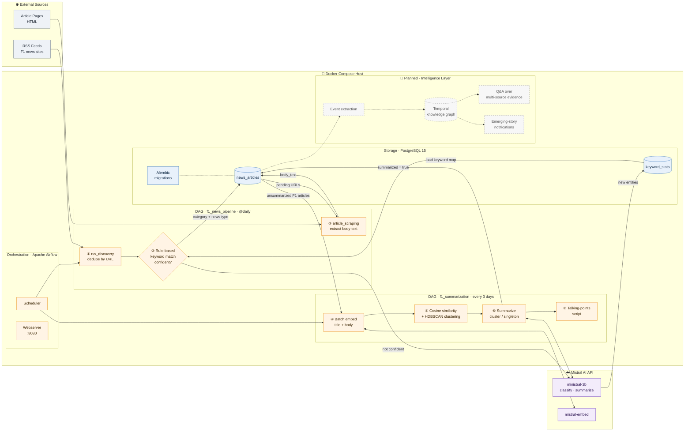

# F1 Intelligence Platform

A platform that ingests Formula 1 news, uses LLMs to work out what happened, and links events, drivers, teams and races over time.

## System Design



**Legend:** solid arrows are built · dashed boxes and arrows are planned · circled numbers are the order of processing

| Component | Code |
|---|---|
| Airflow DAGs | [dags/](dags/) |
| RSS discovery + classification | [scrapers/rss_discovery.py](scrapers/rss_discovery.py), [utils/classify_motorsports.py](utils/classify_motorsports.py) |
| Article scraping | [scrapers/article_scraper.py](scrapers/article_scraper.py) |
| Embedding, clustering, summaries | [pipeline/summarization_job.py](pipeline/summarization_job.py), [utils/llm_call.py](utils/llm_call.py) |
| Database access | [db/postgres_utils.py](db/postgres_utils.py), [alembic/](alembic/) |

## Run

```bash
docker compose up --build   # Airflow UI at http://localhost:8080
```

Needs a `.env` file with `MISTRAL_API_KEY` and the database connection settings.
